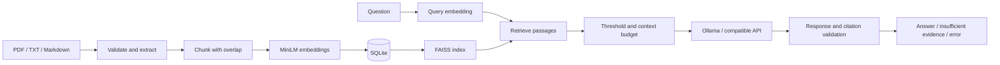

# EvidenceRAG

**Local document search and evidence-grounded question answering.**

EvidenceRAG indexes PDF, text, and Markdown documents, retrieves relevant passages with semantic search, and generates answers through a configurable language model. Every supplied passage retains its document name, page, and character offsets. Citation validation connects generated answers to the retrieved evidence.

Document ingestion and search run locally without an LLM account. Generation supports Ollama and OpenAI-compatible chat APIs.

## Capabilities

- PDF page extraction and UTF-8 text/Markdown ingestion with file validation.
- SHA-256 duplicate detection and stable passage identifiers.
- Fixed or recursive character chunking with overlap.
- Local MiniLM embeddings and exact FAISS cosine-similarity search.
- Transactional SQLite storage for original documents, extracted pages, metadata, and vectors.
- Document deletion, persistent storage, and automatic FAISS reconstruction after restart.
- FastAPI endpoints and a Streamlit interface for upload, search, and question answering.
- Bounded evidence context, validated citation identifiers, and explicit answer, abstention, and error states.

## Architecture



SQLite is authoritative; FAISS is a rebuildable cache. Each ingestion commits document data and vectors together before rebuilding the index. Startup reconstructs the index from stored vectors without re-embedding. One process owns each data directory, and an in-process lock serializes document and retrieval operations.

## Stack

Python 3.11 · FastAPI · Streamlit · Sentence Transformers · FAISS · SQLite · PyMuPDF · Pydantic · pytest

## Installation

```bash
git clone https://github.com/Nishanth30/EvidenceRAG.git
cd EvidenceRAG
python3.11 -m venv .venv
source .venv/bin/activate
pip install -r requirements-lock.txt
cp .env.example .env
```

The lock file records the validated macOS environment. `requirements.txt` contains version ranges for platforms where those exact native wheels are unavailable.

The first ingestion or nonempty search downloads the pinned MiniLM model. The cache resides in `data/models`; `HF_HUB_OFFLINE=1` enables offline operation after the download.

### Backend

```bash
uvicorn app.main:app --host 127.0.0.1 --port 8000 --workers 1
```

### Frontend

```bash
streamlit run frontend/streamlit_app.py --server.address 127.0.0.1 --server.port 8501
```

Interface: [localhost:8501](http://127.0.0.1:8501). API documentation: [localhost:8000/docs](http://127.0.0.1:8000/docs).

### Sample documents

```bash
python scripts/ingest_samples.py
```

The included corpus covers transactions, message delivery, distributed services, retrieval, and observability. Each question is retrieved independently; displayed conversation history is not sent as model memory.

## LLM configuration

Generation is disabled by default. Configuration is loaded from `.env`; changes require a backend restart. Questions and selected passages are sent to the configured provider.

### Local Ollama

With Ollama installed and running:

```bash
ollama pull qwen2.5:3b
```

```dotenv
LLM_PROVIDER=ollama
LLM_BASE_URL=http://127.0.0.1:11434
LLM_MODEL=qwen2.5:3b
```

The client uses `/api/chat`, JSON output mode, temperature zero, and non-streaming responses. Qwen2.5 3B was validated locally; model weights are downloaded separately and are not included in the repository.

### OpenAI-compatible endpoint

```dotenv
LLM_PROVIDER=openai
LLM_BASE_URL=https://api.openai.com/v1
LLM_MODEL=YOUR_AVAILABLE_MODEL
LLM_API_KEY=YOUR_KEY
```

The client appends `/chat/completions` and sends `temperature=0`, `max_tokens=700`, and `stream=false`. Endpoint/model compatibility is required. This provider path has mocked contract tests; live generation was validated only with Ollama.

## Configuration

Full configuration: [.env.example](.env.example).

| Setting | Default | Purpose |
|---|---|---|
| `DATA_DIR` | `data` | Database, index, and model cache |
| `CHUNK_STRATEGY` | `recursive` | Recursive or fixed character windows |
| `CHUNK_SIZE` / `CHUNK_OVERLAP` | `800` / `150` | Passage size and overlap |
| `TOP_K` | `6` | Default retrieval count; request override: 1–20 |
| `SIMILARITY_THRESHOLD` | `0.3` | Minimum passage score for generation |
| `MAX_CONTEXT_CHARS` | `6000` | Passage-text budget, excluding prompt overhead |
| `MAX_UPLOAD_MB` | `10` | Per-file upload limit |
| `LLM_TIMEOUT_SECONDS` | `90` | Provider request timeout |

Embeddings use the pinned `all-MiniLM-L6-v2` revision specified in `.env.example`, with 384 normalized dimensions. Existing databases reject incompatible embedding or chunking settings. A different index configuration requires a separate data directory and reingestion.

The native runtime defaults to one OpenMP thread after a combined FAISS/PyTorch crash was reproduced on macOS with default threading. The validated configuration uses CPU embeddings and one backend worker.

## API

| Method | Endpoint | Purpose |
|---|---|---|
| `POST` | `/documents` | Upload and index a document |
| `GET` | `/documents` | List indexed documents |
| `DELETE` | `/documents/{id}` | Delete a document and its passages |
| `POST` | `/search` | Retrieve passages, scores, and source locations |
| `POST` | `/ask` | Generate an answer with evidence and status |
| `GET` | `/health` | Report process, index, and provider configuration status |

```bash
curl -F 'file=@sample_documents/message_delivery.md;type=text/markdown' http://127.0.0.1:8000/documents
curl -H 'Content-Type: application/json' -d '{"query":"When should a consumer acknowledge a message?"}' http://127.0.0.1:8000/ask
```

Duplicate file bytes return `409`, invalid query parameters `422`, oversized uploads `413`, and unsupported formats `415`. Health checks report provider configuration without performing inference.

### Answer contract

- **`answered`**: nonempty answer with a nonempty list of valid supplied source IDs. Optional inline citations must agree with the list. The interface marks cited passages.
- **`insufficient_evidence`**: empty/below-threshold retrieval or an explicit structured model abstention. The API supplies a standard refusal without fabricated citations.
- **`error`**: unavailable provider, malformed model output, or invalid citations. `error_code` identifies the generation failure; invalid output is withheld.

The model envelope contains exactly `status`, `answer`, and `citations`. Duplicate keys, extra fields, incorrect types, and contradictory abstentions are rejected. Underlying request, retrieval, and storage failures retain HTTP error handling.

## Evaluation

Five educational documents and 28 development questions were evaluated with real MiniLM embeddings: 24 answerable questions and four negatives.

| Chunk size / overlap | Chunks | Recall@3 | Recall@5 | MRR@5 | Warm p50 | Warm p95 |
|---|---:|---:|---:|---:|---:|---:|
| 500 / 100 | 31 | 89.58% | 93.75% | 0.8576 | 2.62 ms | 3.02 ms |
| 1000 / 150 | 16 | 100% | 100% | 1.0000 | 2.61 ms | 2.91 ms |

Recall measures the fraction of labeled evidence units retrieved. Latency includes query encoding and retrieval, excluding HTTP, model loading, and answer generation. Measurements are specific to the recorded local environment.

The corpus and candidate questions are AI-authored development examples, not an independently adjudicated or held-out benchmark. A separate 10-question audit includes six answerable cases and four harder near-topic negatives. All four harder negatives exceeded the similarity threshold, demonstrating that topical similarity alone cannot establish answerability.

Three real Qwen2.5 3B queries produced:

| Scenario | Result |
|---|---|
| Direct acknowledgement question | Grounded answer with a valid source citation |
| Paraphrased concurrent-processing question | Relevant evidence retrieved and cited; causal explanation remained imprecise |
| Missing numeric retry limit | Correctly classified insufficient evidence, without citations |

The default retrieval count of six includes decisive evidence that ranked sixth for the paraphrased question. This is a targeted development-case adjustment, not a demonstrated general improvement.

Artifacts: [retrieval measurements](evaluation/RESULTS.md), [dataset review](evaluation/DATASET_AUDIT.md), and [generation validation](CORRECTIVE_VALIDATION.md). Original measurements and unsuccessful intermediate generation runs are retained.

## Tests

```bash
pytest -q
ruff check app frontend evaluation tests scripts
python scripts/smoke_model.py
python -m evaluation.evaluate --repeats 3
```

The automated suite contains **55 passing tests**, covering ingestion, duplicate uploads, persistence, deletion, cache recovery, response contracts, citations, provider failures, and evaluation arithmetic. Unit/API tests use deterministic embeddings and mocked LLM responses. Separate smoke tests, retrieval evaluation, and recorded Ollama calls exercise real inference.

## Storage and deployment

The `data/` directory and `.env` are excluded from version control. SQLite stores original file bytes and extracted text as well as vectors. Consistent backups require SQLite's backup API or a stopped backend; FAISS files alone are not a backup. Document deletion is logical deletion, not secure erasure of backups or disk pages.

Docker and Compose definitions are included. Compose configuration was validated, but image builds and container execution remain untested. The application supports one backend worker per data directory.

## Limitations

- Citation checks establish source identity, not whether every generated claim follows from the evidence. Incorrect answers with valid IDs remain possible.
- Abstention depends on an uncalibrated similarity threshold and model-reported answerability. Three live questions do not establish general faithfulness or rejection accuracy.
- Character-based chunks can exceed the encoder's token limit. There is no OCR, table/layout reconstruction, or cross-page chunking.
- Retrieval uses dense exact search without keyword search or reranking. Full index rebuilds and in-memory metadata limit scalability.
- Public hosting requires authentication, access isolation, request limits, transport protection, and a document-parsing security boundary.
- Prompt separation reduces exposure to document instructions but does not prove resistance to prompt injection.
- Production concurrency, broad answer quality, live OpenAI-compatible generation, and Docker execution have not been validated.

Sample-document and dataset terms are recorded in [sample_documents/README.txt](sample_documents/README.txt). Third-party model and dependency licenses remain separate.
